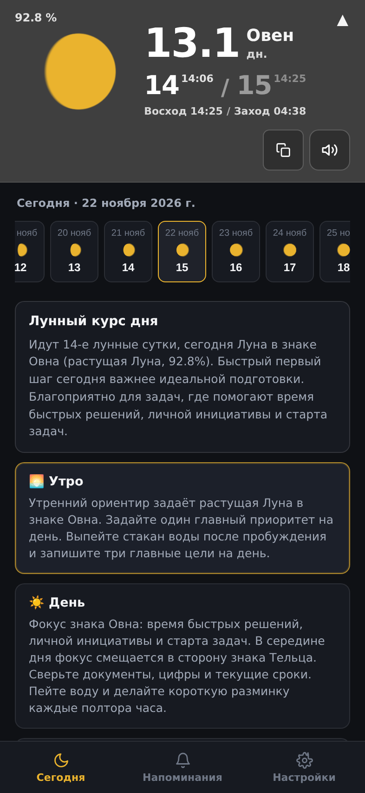
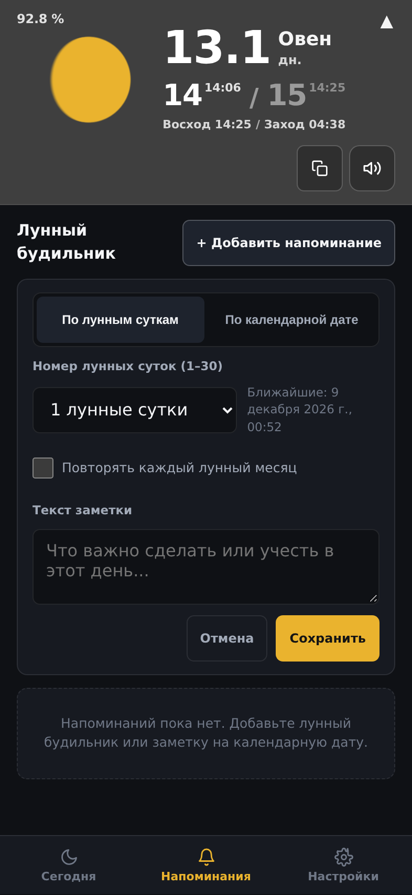
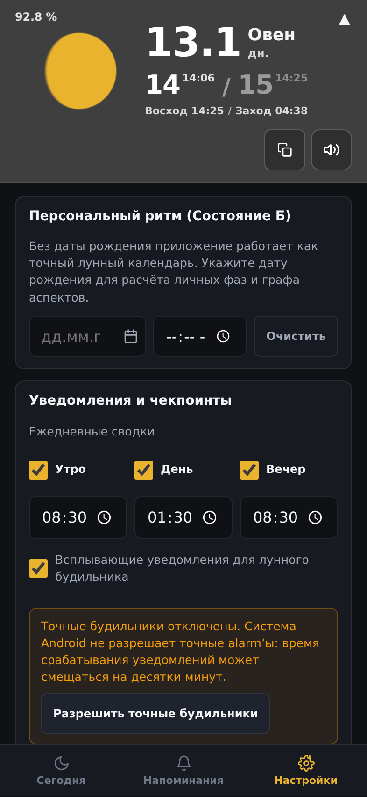

# Ритм Дня / Lunar Rhythm Navigator — Mobile (Android, Capacitor)

**Нативное Android-приложение** на базе **Capacitor 6**, портированное из Chrome-расширения
[`lunar-rhythm-ext`](https://github.com/vasiliypavlov/lunar-rhythm-ext).

Автономный астрономический лунный календарь, персональный 4-фазный навигатор ритмов,
лунный будильник с push-уведомлениями в шторке Android, нативная озвучка сводок (TTS)
и система подключаемых JSON-словарей — всё работает **полностью офлайн и без серверов**.

<p align="center">
  
  
  
</p>

---

## Что перенесено из расширения без изменений

| Компонент | Файл | Состояние |
|---|---|---|
| Математическое ядро (алгоритмы Meeus / Schlyter, фазы, аспекты, сырые данные) | `www/astro_engine.js` | **байт-в-байт идентичен** оригиналу |
| Базовый словарь + 5 встроенных языков | `www/dictionary_default.js` | **байт-в-байт идентичен** |
| Словари `ru`, `en`, `es`, `de`, `fr` | `www/dict_*.js` | **байт-в-байт идентичны** (5 × 615 строк) |
| Процедурная отрисовка Луны (Canvas, попиксельный расчёт терминатора) | `www/app.js` → `renderMoonCanvas()` | сохранена |
| Генератор промптов для внешней ИИ-модели | `www/app.js` → `buildExternalAIPrompt()` | сохранён |
| Экспорт Raw Data (JSON) | `www/app.js` → `computeRawDiagnosticData()` | сохранён |
| Кастомные JSON-темы (загрузка / скачивание шаблона / deep merge) | `www/app.js` | сохранена |

Проверить, что ядро не менялось:

```bash
for f in astro_engine.js dictionary_default.js dict_ru.js dict_en.js dict_es.js dict_de.js dict_fr.js; do
  diff -q "www/$f" "../lunar-rhythm-ext/$f" && echo "OK  $f"
done
```

---

## Что изменено под Android

### Вёрстка (`www/styles.css`, `www/index.html`)
* Убраны фиксированные `width: 400px; height: 600px` — теперь резиновая колонка
  `width: 100%; min-height: 100dvh; max-width: 540px; margin: 0 auto;`.
* Поддержка системных отступов: `env(safe-area-inset-top)` для шапки,
  `env(safe-area-inset-bottom)` для нижней навигационной панели
  (в `index.html` добавлен `viewport-fit=cover`).
* Все интерактивные элементы (кнопки, вкладки, поля ввода, переключатели) увеличены
  до **минимум 44 px** — комфортно для пальца на сенсорном экране.
* Добавлен `viewport-fit=cover`, `theme-color`, `manifest.webmanifest` (PWA-режим).

### Хранение (`www/platform/storage.js`)
`chrome.storage.local` → **`@capacitor/preferences`** (SharedPreferences на Android),
с прозрачным фолбэком на `localStorage` для предпросмотра в браузере.
Состояние (настройки, дата/время рождения, активный словарь, список напоминаний)
хранится единым JSON-объектом — запись атомарна.

### Уведомления (`www/platform/notifications.js`)
`chrome.alarms` + `chrome.notifications` + Service Worker → **`@capacitor/local-notifications`** (AlarmManager).

* Разрешение запрашивается **при старте приложения** и **при каждом изменении настроек**
  (`LocalNotifications.requestPermissions()`).
* Планируются: ежедневные чекпоинты **Утро / День / Вечер** и **лунные будильники**
  (номер лунных суток `1..30` с ежемесячным повтором, а также конкретные календарные даты).
* Создаются два канала Android 8+ с системным звуком:
  `lunar_checkpoint` (ежедневные сводки) и `lunar_alarm` (лунный будильник).
* Уведомление приходит в шторку Android с заголовком и текстом сводки/напоминания
  и звучит системным звуком уведомления.
* **Точное время без дрейфа.** В Android `setRepeating` считает период как
  «дата первого срабатывания минус сейчас», из-за чего ежедневный будильник
  постепенно смещается. Поэтому на каждый чекпоинт планируется серия одноразовых
  alarm'ов с точным временем на 30 дней вперёд, а серия пересобирается при каждом
  запуске и возврате в приложение.
* Если Android запрещает точные alarm'ы (Android 12+), в настройках появляется
  кнопка перехода в системный экран разрешения.

### Поведение при срабатывании и тапе
* Сработавший лунный будильник активирует индикатор **🔔 в левом нижнем углу шапки**
  (как в расширении). Состояние сверяется при запуске и при возврате в приложение
  (`@capacitor/app`, событие `appStateChange`).
* **Тап по уведомлению в шторке** (`localNotificationActionPerformed`) открывает
  приложение и **автоматически запускает озвучку**: для будильника — текст напоминания,
  для чекпоинта — сводку ритма (ровно как в расширении).

### Озвучка (`www/platform/speech.js`)
* Основной движок — нативный **`@capacitor-community/text-to-speech`**:
  `TextToSpeech.speak({ text, lang: dict.meta.lang, rate: 1.0 })`.
  В Android WebView стандартный `window.speechSynthesis` часто не видит голоса —
  поэтому нативный TTS стоит первым.
* `window.speechSynthesis` остаётся **запасным вариантом** (предпросмотр в браузере,
  либо если нативный движок не поддерживает язык словаря).
* Язык подбирается автоматически по `meta.lang` активного словаря.
* **Мягкий навигационный джингл** (Web Audio API, C5 + E5) сохранён и играет
  перед началом речи.

---

## Сборка .apk через GitHub Actions (самый простой способ)

Workflow уже лежит в репозитории: **`.github/workflows/build-apk.yml`**.

1. Запушьте изменения в репозиторий на GitHub (ветка `main` или `master`).
   Workflow запустится автоматически (также доступен ручной запуск:
   вкладка **Actions** → **Build APK** → **Run workflow**).
2. Откройте вкладку **Actions** в репозитории и выберите последний запуск
   **«Сборка .apk (Android)»**.
3. Дождитесь зелёной галочки (обычно 3–6 минут).
4. Внизу страницы запуска найдите раздел **Artifacts** и скачайте:
   * `lunar-rhythm-mobile-debug-apk` → **`app-debug.apk`** — подписан отладочным
     ключом, ставится на телефон сразу;
   * `lunar-rhythm-mobile-release-unsigned-apk` → **`app-release-unsigned.apk`** —
     без подписи, нужен свой ключ (см. ниже).
5. Скачанный `.apk` положите на телефон и установите. Если Android спросит
   разрешение на установку из неизвестных источников — разрешите его для того
   приложения, из которого открываете файл.

### Что делает workflow
`npm ci` → `npx cap add android` → `node scripts/prepare-android.mjs`
(разрешения в `AndroidManifest.xml` + иконки) → `npx cap sync android` →
`./gradlew assembleDebug` и `assembleRelease` → загрузка `.apk` в **Artifacts**.

Workflow сам добавляет в `AndroidManifest.xml` разрешения:
`SCHEDULE_EXACT_ALARM`, `USE_EXACT_ALARM`, `POST_NOTIFICATIONS`,
`RECEIVE_BOOT_COMPLETED`, `VIBRATE`, `WAKE_LOCK`.

### Подпись release-сборки своим ключом

```bash
keytool -genkey -v -keystore my-release.keystore -alias lunar \
        -keyalg RSA -keysize 2048 -validity 10000

# в android/app/build.gradle внутри buildTypes { release { ... } }:
#   signingConfig signingConfigs.release
# и создать signingConfigs.release с storeFile / storePassword / keyAlias / keyPassword
```

---

## Локальная сборка через Android Studio

1. Установите [Android Studio](https://developer.android.com/studio) (Lighthouse или новее)
   и **JDK 17** (Android Studio поставляет свой).
2. Клонируйте репозиторий и перейдите в папку проекта:
   ```bash
   git clone https://github.com/vasiliypavlov/lunar-rhythm-mobile.git
   cd lunar-rhythm-mobile
   ```
3. Установите зависимости и создайте Android-проект:
   ```bash
   npm install
   npx cap add android          # только если папки android/ ещё нет
   node scripts/prepare-android.mjs
   npx cap sync android
   ```
4. Откройте папку проекта в Android Studio: **File → Open… → `lunar-rhythm-mobile/android`**.
   Дождитесь синхронизации Gradle.
5. Подключите телефон (включите «Отладка по USB») или запустите на эмуляторе,
   либо соберите APK: **Build → Build Bundle(s) / APK(s) → Build APK(s)**.
   Готовый файл:
   `android/app/build/outputs/apk/debug/app-debug.apk`.

### Сборка из командной строки (без Android Studio)

```bash
npm install
npx cap add android
node scripts/prepare-android.mjs
npx cap sync android
cd android && ./gradlew assembleDebug
# → android/app/build/outputs/apk/debug/app-debug.apk
```

Требуются JDK 17 и Android SDK (переменные `JAVA_HOME` и `ANDROID_HOME`).

---

## Предпросмотр в браузере (без Android)

```bash
npx serve www      # или любой статический сервер
```

В браузере нативные плагины недоступны, поэтому приложение автоматически
переключается на `localStorage` и `window.speechSynthesis` — весь контент
и математика работают как обычно.

---

## Структура проекта

```
lunar-rhythm-mobile/
├── .github/workflows/build-apk.yml   # автосборка .apk в GitHub Actions
├── capacitor.config.json             # appId / appName / webDir / иконка уведомления
├── package.json                      # зависимости Capacitor и плагинов
├── scripts/
│   ├── prepare-android.mjs           # разрешения в AndroidManifest.xml + иконки
│   └── test-app.mjs                  # интеграционный тест (headless Chromium)
├── www/                              # webDir — исходники веб-приложения
│   ├── index.html
│   ├── styles.css
│   ├── app.js                        # логика приложения
│   ├── astro_engine.js               # ← ядро (не изменялось)
│   ├── dictionary_default.js         # ← не изменялось
│   ├── dict_ru.js  dict_en.js        # ← не изменялись
│   ├── dict_es.js  dict_de.js        # ← не изменялись
│   ├── dict_fr.js                    # ← не изменялся
│   ├── manifest.webmanifest
│   ├── icons/
│   └── platform/
│       ├── capacitor.js              # адаптер над нативным мостом Capacitor
│       ├── storage.js                # @capacitor/preferences + localStorage
│       ├── notifications.js          # @capacitor/local-notifications
│       └── speech.js                 # @capacitor-community/text-to-speech
├── docs/                             # скриншоты расширения
└── android/                          # генерируется автоматически (в репозиторий не коммитится)
```

---

## Проверка изменений

```bash
# синтаксис всех JS-модулей
npm run check:js

# интеграционный тест в headless-браузере с моком нативного моста
node scripts/test-app.mjs
```

---

## Разрешения Android

| Разрешение | Зачем |
|---|---|
| `POST_NOTIFICATIONS` | показ уведомлений в шторке (Android 13+) |
| `SCHEDULE_EXACT_ALARM` / `USE_EXACT_ALARM` | точные alarm'ы для чекпоинтов и будильников (Android 12+) |
| `RECEIVE_BOOT_COMPLETED` | восстановление будильников после перезагрузки |
| `VIBRATE`, `WAKE_LOCK` | вибрация и корректная работа в режиме Doze |
| `INTERNET` | добавляется шаблоном Capacitor (сам приложение сеть не использует) |

---

## License / Лицензия

This project is licensed under the **GNU General Public License v3.0 (GPL-3.0)** — see the [LICENSE](LICENSE) file for details. Any derivative works or modified distributions must also be released under the same GPL-3.0 license.

Проект распространяется под лицензией **GNU General Public License v3.0 (GPL-3.0)** — подробности в файле [LICENSE](LICENSE). Любые производные работы и модификации также должны распространяться с открытым исходным кодом под лицензией GPL-3.0.
