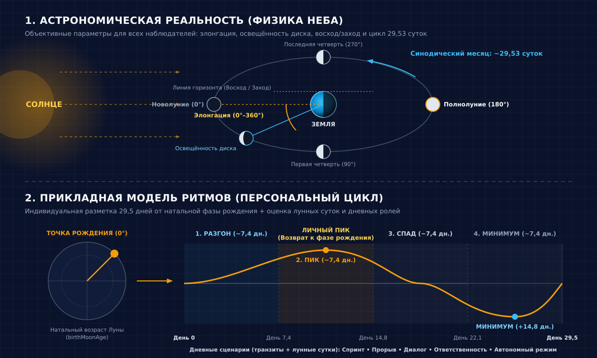
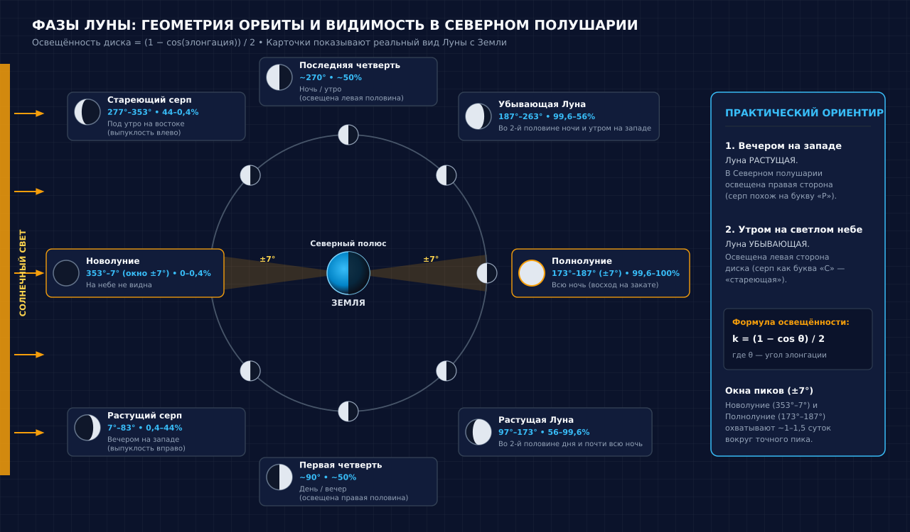
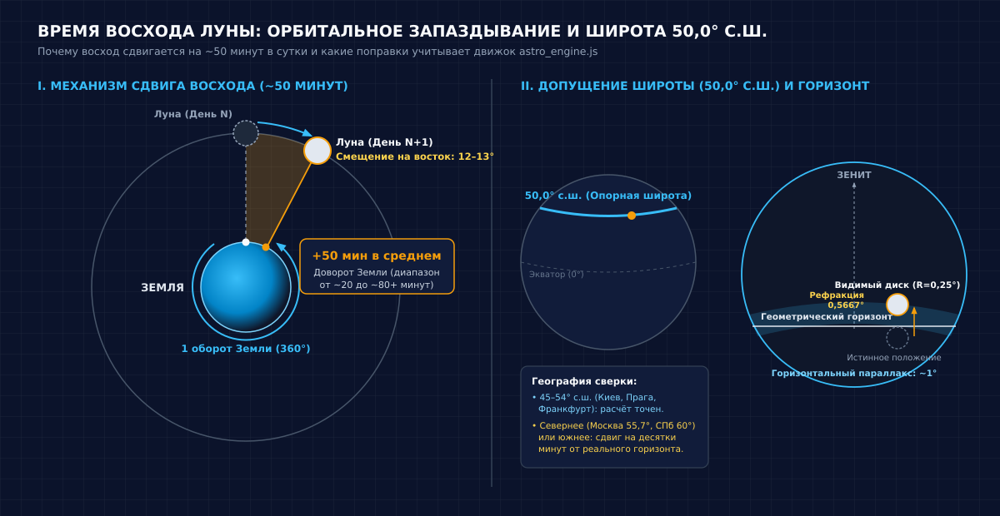
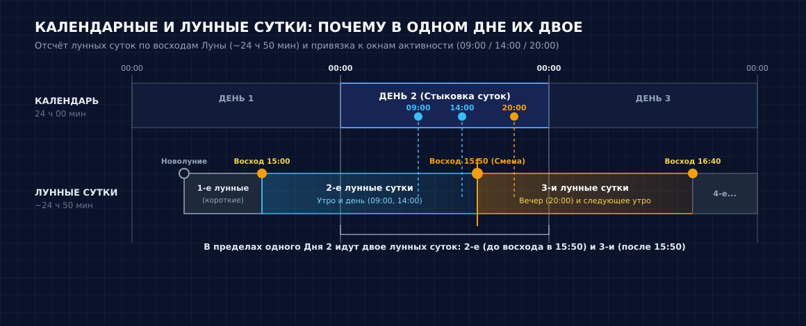
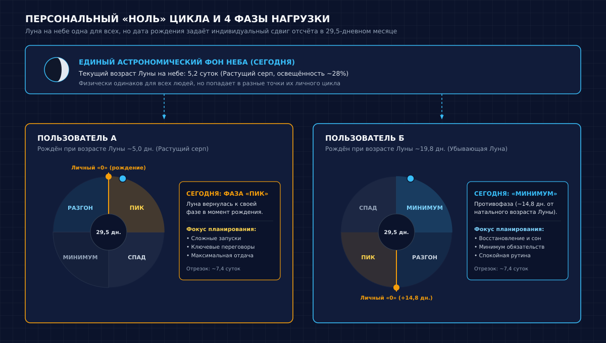
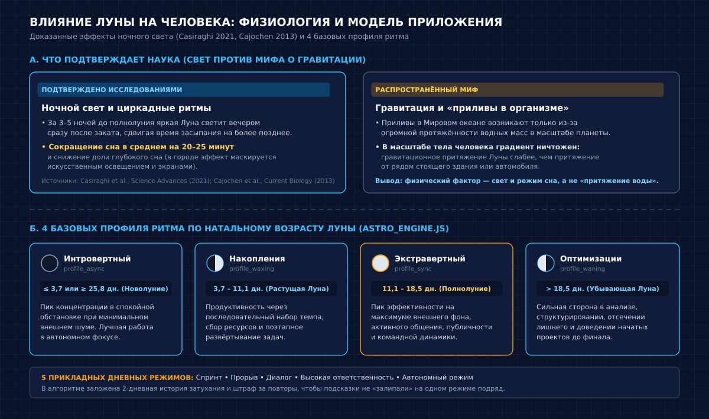
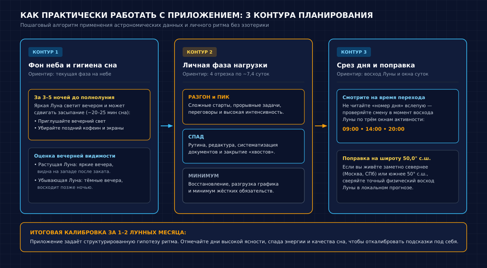

# Справка по работе с Луной и приложением Lunar Rhythm Navigator

Эта справка объясняет не кнопки интерфейса, а **физическую реальность за числами** в расширении [Lunar Rhythm Navigator (`lunar-rhythm-ext`)](https://github.com/vasiliypavlov/lunar-rhythm-ext): как устроены лунные циклы в небе, что означают расчёты в астрономическом движке [astro_engine.js](https://github.com/vasiliypavlov/lunar-rhythm-ext/blob/main/astro_engine.js) и как применять эти ориентиры в повседневной жизни без эзотерики — в соответствии со светской моделью словаря [dict_ru.js](https://github.com/vasiliypavlov/lunar-rhythm-ext/blob/main/dict_ru.js).

## 1. Как модель приложения соотносится с реальным небом

Приложение работает полностью автономно (оффлайн) и вычисляет положение Солнца, Луны и планет по классическим астрономическим алгоритмам Жана Меёса (*Astronomical Algorithms*) и орбитальным рядам Пола Шлитера ([astro_engine.js](https://github.com/vasiliypavlov/lunar-rhythm-ext/blob/main/astro_engine.js)).

Чтобы правильно сопоставлять данные на экране с тем, что вы видите над головой и чувствуете в течение дня, важно разделять два слоя:

1. **Астрономическая реальность** — угловое расстояние между Луной и Солнцем, освещённость диска, время восхода/захода Луны и длительность синодического месяца (~29,53 суток).

2. **Прикладная модель ритмов** — привязка вашего личного 29,5-дневного цикла к фазе Луны в момент рождения, а также оценка повседневной динамики (лунные сутки и дневные роли).

## 2. Фазы Луны: геометрия неба и видимость

### Физический смысл

Луна не светится сама — она отражает солнечный свет. По мере того как Луна обращается вокруг Земли, меняется угол между направлением на Солнце и направлением на Луну (**элонгация**, от `0°` до `360°`). Полный цикл смены фаз от одного новолуния до следующего называется **синодическим месяцем** и в среднем длится **29,53059 суток** ([astro_engine.js](https://github.com/vasiliypavlov/lunar-rhythm-ext/blob/main/astro_engine.js)).

* **Освещённость диска** зависит исключительно от элонгации: `(1 − cos(элонгация)) / 2`.

* **Возраст Луны** — это просто время, прошедшее с момента последнего точного астрономического новолуния (от `0` до `~29,53` дней).

### Как читать фазы на небе и в приложении

В движке [astro_engine.js](https://github.com/vasiliypavlov/lunar-rhythm-ext/blob/main/astro_engine.js) выделяются 4 базовых тренда и 8 детальных фаз. При этом «новолуние» и «полнолуние» для удобства интерпретации охватывают окно **`±7°`** вокруг точных значений `0°` и `180°` (примерно по 1–1,5 суток вокруг астрономического пика).

| Фаза в приложении | Элонгация и освещённость | Где и когда искать Луну в реальном небе |
| :--- | :--- | :--- |
| **Новолуние** (`new_moon`) | `353°–7°` (0–0,4%) | Луна рядом с Солнцем, повёрнута к Земле неосвещённой стороной. На небе не видна. |
| **Растущий серп** (`waxing_crescent`) | `7°–83°` (0,4–44%) | Видна **вечером** в западной части неба сразу после заката; серп обращён выпуклостью вправо (в Северном полушарии). |
| **Первая четверть** (`first_quarter`) | `~90°` (~50%) | Освещена правая половина диска. Восходит около полудня, высоко на юге к закату, заходит около полуночи. |
| **Растущая Луна** (`waxing_gibbous`) | `97°–173°` (56–99,6%) | Видна во второй половине дня и почти всю ночь до глубокой ночи; с каждым днём светит ярче. |
| **Полнолуние** (`full_moon`) | `173°–187°` (99,6–100%) | Луна напротив Солнца: восходит на востоке почти одновременно с закатом и заходит на западе на рассвете. |
| **Убывающая Луна** (`waning_gibbous`) | `187°–263°` (99,6–56%) | Восходит позже вечером, ярко светит во второй половине ночи и остаётся видимой утром на западе. |
| **Последняя четверть** (`last_quarter`) | `~270°` (~50%) | Освещена левая половина диска. Восходит около полуночи, высоко на юге на рассвете, заходит около полудня. |
| **Стареющий серп** (`waning_crescent`) | `277°–353°` (44–0,4%) | Видна **под утро** на востоке перед самым рассветом; серп обращён выпуклостью влево. |

> **Практический ориентир:** Если вы видите Луну вечером на западе — она **растущая** (освещена правая сторона в Северном полушарии). Если видите её утром на светлом небе — она **убывающая**.

## 3. Время восхода и захода Луны

### Почему Луна каждый день «опаздывает»

Земля вращается вокруг своей оси, поэтому Луна, как и Солнце, восходит на востоке и заходит на западе. Но пока Земля делает один оборот, Луна успевает сместиться по своей орбите на восток примерно на **12–13°**. Чтобы «догнать» Луну, Земле нужно довернуться ещё примерно на **50 минут**.

Из-за этого:

* Каждый следующий восход Луны происходит в среднем на **50 минут позже** (в реальности сдвиг колеблется от ~20 до ~80+ минут из-за наклона лунной орбиты и эклиптики к горизонту).

* В отличие от Солнца, Луна регулярно восходит **днём** (например, вблизи первой четверти) и заходит днём (вблизи последней четверти).

* В отдельные календарные сутки восход или заход Луны может **не произойти вовсе**: если сегодня Луна взошла в `23:40`, следующий восход будет уже послезавтра около `00:30`.

### Что именно считается моментом восхода/захода в движке

Луна находится близко к Земле (~384 400 км), поэтому её видимое положение заметно зависит от точки наблюдения на поверхности Земли (**горизонтальный параллакс** достигает `~1°`). В [astro_engine.js](https://github.com/vasiliypavlov/lunar-rhythm-ext/blob/main/astro_engine.js) момент пересечения горизонта вычисляется с учётом:

* горизонтального параллакса Луны;

* атмосферной рефракции (`0,5667°`, из-за которой атмосфера «приподнимает» светило над горизонтом);

* видимого углового радиуса лунного диска (`0,25°`).

### Важное географическое допущение приложения

В коде [astro_engine.js](https://github.com/vasiliypavlov/lunar-rhythm-ext/blob/main/astro_engine.js) (`getObserverCoords`) долгота наблюдателя определяется автоматически по часовому поясу браузера, **а широта жёстко зафиксирована на `50,0°` с.ш.** Разработчик сделал это намеренно, чтобы Луна гарантированно восходила и заходила в каждом цикле без приполярных краевых эффектов.

**Что это значит при сверке с реальностью:**

* **Если вы находитесь в полосе ~45–54° с.ш.** (Центральная Европа, Киев, Харьков, Прага, Франкфурт, Виннипег), время восхода и захода в приложении близко к фактическому (возможна поправка лишь на то, насколько ваша реальная долгота отличается от центрального меридиана вашего часового пояса).

* **Если вы живёте заметно севернее (Москва 55,7° с.ш., Санкт-Петербург 60° с.ш.) или южнее (30° с.ш. и ниже, а также в Южном полушарии)** — фактическое время восхода и захода Луны на вашем горизонте может отличаться от расчётного в приложении на десятки минут и более, а вблизи полярного круга Луна может не заходить сутками.

## 4. Что такое лунные сутки и как они связаны с календарём

**Лунные сутки** — это не календарный день от полуночи до полуночи, а интервал между событиями в движении Луны. Приложение использует классическую астрономическую систему отсчёта **по восходам Луны** ([astro_engine.js](https://github.com/vasiliypavlov/lunar-rhythm-ext/blob/main/astro_engine.js)):

1. **1-е лунные сутки** начинаются в точный момент **астрономического новолуния** и заканчиваются в момент **первого восхода Луны** после него.

   * *Важная особенность:* так как новолуние может случиться и за 15 минут до восхода Луны, и сразу после него, 1-е лунные сутки почти всегда **короче обычных** — от нескольких минут до ~24 часов.

2. **2-е — 29-е (или 30-е) лунные сутки** отсчитываются строго **от одного восхода Луны до следующего восхода**. Их средняя длительность — около **24 часов 50 минут** (дольше солнечных суток).

3. **Последние лунные сутки** (29-е или 30-е) заканчиваются в момент **следующего новолуния**. Поскольку синодический месяц длится ~29,53 дня, примерно в половине месяцев 30-е лунные сутки вообще не наступают (месяц завершается на 29-х), а если наступают — тоже бывают короткими.

### Почему на один календарный день приходится двое лунных суток

Поскольку лунные сутки (~24 ч 50 мин) не совпадают с полуночью, почти в каждый календарный день происходит смена лунных суток — в момент восхода Луны.

* Именно поэтому приложение показывает для дня **первые и вторые лунные сутки**, **точное время перехода** (восход Луны) и разбивку по трём бытовым окнам активности (**09:00, 14:00, 20:00**): так сразу понятно, какие лунные сутки идут утром, а какие — вечером.

## 5. Зачем вводить дату рождения, если Луна одна для всех?

С точки зрения физики неба Луна действительно абсолютно одинакова для вас, соседа по улице и собаки у подъезда: в один и тот же вечер над городом висит одна фаза, с одной освещённостью и одним временем восхода. Никакой «персональной Луны» в физическом пространстве не существует.

Дата рождения нужна приложению не для описания неба, а как **индивидуальная точка отсчёта (нулевая фаза)** для вашего личного графика нагрузок и отдыха ([astro_engine.js](https://github.com/vasiliypavlov/lunar-rhythm-ext/blob/main/astro_engine.js)):

1. **Фиксация личного «нуля» в 29,5-дневном цикле.** В день вашего рождения Луна находилась в определённой фазе (`birthMoonAge` — от `0` до `29,53` дней). Приложение берёт эту точку за ваш личный старт цикла: когда Луна на небе снова возвращается в ту же фазу, что была при рождении, для вас наступает условный **«Пик»**, а через половину месяца (~14,8 дней) — **«Минимум»**. Так у вас и у соседа на фоне одного и того же неба получаются разные фазы планирования, а не одинаковый шаблон для всех сразу.

2. **Привязка натальных координат для дневных ролей.** Кроме возраста Луны, движок запоминает положение Солнца, Луны и планет на дату рождения и сравнивает их с текущим положением на небе (транзитами). Например, когда Луна возвращается в тот же участок эклиптики (знак), где была при рождении, алгоритм повышает приоритет «Автономного режима».

3. **Честная научная оговорка.** В современной биологии и физиологии **нет доказательств**, что фаза Луны в день рождения физически программирует гормональные или энергетические циклы взрослого человека. В этом приложении дата рождения — это **прикладной инструмент самоорганизации (персональный «якорь» ритма)**: он автоматически делит ваш месяц на четыре понятных отрезка по ~7,4 дня (**Разгон → Пик → Спад → Минимум**), чтобы вы не работали на износ в одном темпе круглый год.

> **Итог для практики:** общие астрономические данные (свет Луны ночью, фаза на небе, время восхода/захода, лунные сутки) одинаковы для всех. А дата рождения лишь задаёт ваш персональный сдвиг внутри месяца — удобный, но не обязательный к слепой вере ориентир, который лучше всего откалибровать по собственному самочувствию.

## 6. Как Луна влияет на человека: наука и модель приложения

### А. Что подтверждает физиология и исследования сна

1. **Свет и циркадные ритмы.** До появления электричества лунный свет был единственным ярким ночным источником света. Крупное полевое исследование с актиметрией сна в сельских и городских условиях показало, что за **3–5 ночей до полнолуния** (когда яркая Луна светит в вечерние часы сразу после заката) люди склонны засыпать позже, а продолжительность сна сокращается в среднем примерно на **20–25 минут** ([Casiraghi et al., *Science Advances*, 2021](https://pmc.ncbi.nlm.nih.gov/articles/PMC7840136/)). Сходные результаты — снижение доли глубокого сна и сдвиг засыпания вблизи полнолуния — фиксировались и в лабораторных условиях ([Cajochen et al., *Current Biology*, 2013](https://pubmed.ncbi.nlm.nih.gov/23891110/)). При этом результаты разных исследований неоднородны: в современном городе искусственное освещение часто перекрывает эффект лунного света, и чувствительность у разных людей разная ([Sleep Foundation](https://www.sleepfoundation.org/how-sleep-works/do-moon-phases-affect-sleep)).

2. **Гравитация и «приливы в организме» — распространённый миф.** Луна вызывает приливы в Мировом океане за счёт огромной протяжённости водных масс в масштабе планеты. На масштабе человеческого тела гравитационный градиент Луны ничтожен — слабее, чем гравитационное притяжение от рядом стоящего здания или автомобиля. Физическое влияние Луны на человека связано не с «притяжением воды», а с **режимом ночной освещённости, циклом сна-бодрствования и субъективной регуляцией ритма**.

### Б. Персональный ритм и дневные роли в модели приложения

На основе натального возраста Луны [astro_engine.js](https://github.com/vasiliypavlov/lunar-rhythm-ext/blob/main/astro_engine.js) относит пользователя к одному из четырёх базовых профилей ритма:

* **Интровертный ритм** (`profile_async`, рождение вблизи новолуния: `≤ 3,7` или `≥ 25,8` дн.) — пик концентрации в спокойной обстановке;

* **Ритм накопления** (`profile_waxing`, `< 11,1` дн.) — продуктивность через последовательный набор темпа;

* **Экстравертный ритм** (`profile_sync`, `≤ 18,5` дн.) — пик на максимуме внешнего фона и общения;

* **Ритм оптимизации** (`profile_waning`, `> 18,5` дн.) — сильная сторона в анализе, отсечении лишнего и завершении.

Для оценки повседневного фона общения и задач движок учитывает аспекты транзитных планет и переводит их в 5 прикладных сценариев (`Режим спринта`, `Режим прорыва`, `Режим диалога`, `Режим высокой ответственности`, `Автономный режим`). В алгоритме заложена 2-дневная история затухания и штраф за повторы — чтобы рекомендации не «залипали» на одном и том же режиме несколько дней подряд, а помогали гибко переключать фокус внимания.

## 7. Как практически работать с Луной, имея это приложение

1. **Разделяйте «фон неба» и «личный цикл».**

   * По **фазе на небе** оценивайте внешний фон и свой сон: за 3–5 дней до полнолуния стоит бережнее относиться к вечерней гигиене сна (приглушать свет, не планировать поздний кофеин или экранную нагрузку).

   * По **личной фазе** (`Разгон → Пик → Спад → Минимум`) распределяйте сложность работы: сложные старты и прорывные задачи — на **Разгон** и **Пик**; рутину, редактуру и закрытие хвостов — на **Спад**; восстановление и минимум обязательств — на **Минимум**.

2. **Используйте срез лунных суток по времени дня.**

   * Не ориентируйтесь на «номер лунного дня» вслепую — смотрите на **время перехода** (восход Луны) и на то, какие сутки действуют в нужное вам окно (`09:00`, `14:00`, `20:00`).

   * Помните о поправке на широту `50° с.ш.`: если вы находитесь далеко от этой широты и планируете что-то строго к физическому восходу Луны на улице, сверьте точное время восхода для своего города в локальном астрономическом прогнозе.

3. **Калибруйте модель под себя за 1–2 месяца.**

   * Приложение даёт структурированную гипотезу ритма, а не жёсткий закон. Отмечайте в течение одного-двух лунных месяцев дни высокой ясности, спада энергии и качества сна — так вы увидите, какие именно фазы цикла и подсказки из [dict_ru.js](https://github.com/vasiliypavlov/lunar-rhythm-ext/blob/main/dict_ru.js) точнее всего совпадают с вашей реальной физиологией и графиком.

